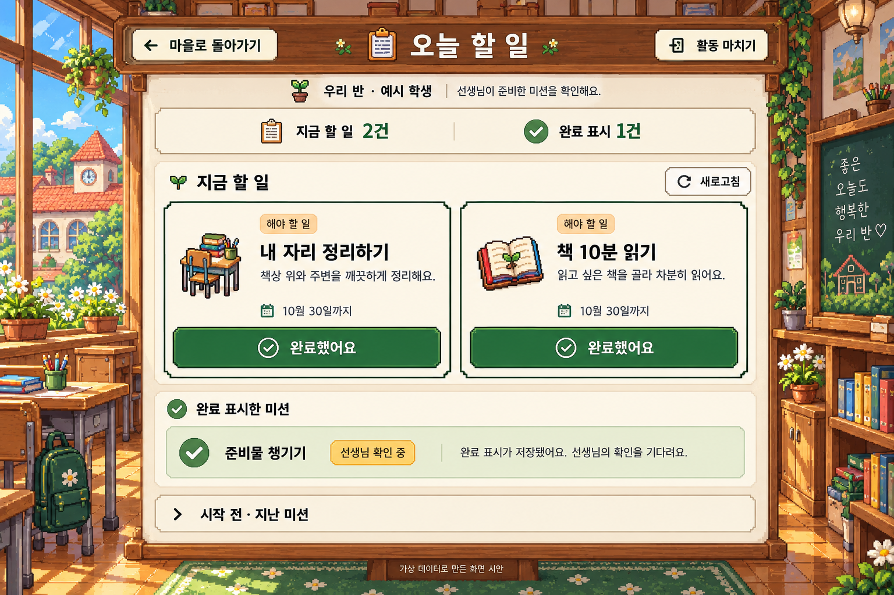

# 우리반 월드 공통 디자인 기준

기준일: 2026-10-30. 이 문서는 사용자가 직접 지정한 ‘오늘 할 일’ 이미지를 학생 기능 화면의 시각 기준으로 고정한다. 메인 도트 마을은 외부 로비이고 아래 화면은 그 마을의 건물 내부다.

제품의 상위 이름은 **우리 반으로, 같이 떠나요**다. 메인 마을은 학급 문맥이며 마니또 시즌명/진행 여부를 전역 상태로 표시하지 않는다. 마니또·오늘 할 일·비밀 우체통·게시판은 나란한 서비스다. 서비스 내부 상태는 해당 건물 안에 표시한다. 데이터/권한의 경계는 [통합 학급 플랫폼 구조](class-platform-architecture.md)를 따른다.

## 기준 이미지와 필수 재질



- 실제 도트 교실: 햇빛이 드는 창, 목재 가구, 식물/책장. 승인된 `today-tasks-classroom-v1.png`를 재사용한다.
- 두꺼운 나무 게시판: 진한 테두리와 밝은 안쪽 테두리, 실제 도트 나뭇결. 기능마다 다른 재질/색으로 새 프레임을 만들지 않는다.
- 불투명 양피지 바탕과 작은 계단 모서리 카드. 본문 뒤에는 풍경/투명 유리 카드가 비치지 않는다.
- 픽셀 클립보드·책상·책·편지 등 실제 bitmap 아이콘. 작은 일반 조작 화살표/닫기 표시는 간결한 HTML/기존 아이콘을 사용해도 된다.
- 큼직한 초록 주행동, 크림 보조행동, 짧고 선명한 한글. 본문 전체를 읽기 어려운 도트 폰트로 바꾸지 않는다.

공통색만 적용하고 둥근 흰 대시보드 카드·단색 배경으로 바꾸면 기준 충족이 아니다. 참고 이미지를 통째 배경으로 깔고 그려진 버튼을 클릭영역으로 쓰는 방식도 사용하지 않는다. 문구/입력/상태/버튼은 실제 HTML이어야 한다.

## 공통 코드

- `web/src/world-design-system.css`: 디자인 토큰과 공통 시각 규칙의 단일 원본.
- `web/src/WorldPage.tsx`: `WorldPageFrame`, `WorldPageHeader`, `WorldPaper`, `WorldButton`, `WorldPixelIcon`.
- `world-feature-shell`: 학생 기능 화면과 사용자가 지정한 선생님 방 허브의 공통 배경. 외부 마을과 로그인은 각각 승인된 별도 장면을 유지한다.
- 각 기능은 공통 파일을 import하고 공통 컴포넌트를 실제 사용한다. 공통 코드를 복사하거나 별도 색/나무 헤더/버튼/CSS 보정 레이어를 만들지 않는다.

```tsx
<WorldPageFrame ariaLabel="기능 이름">
  <WorldPageHeader title="기능 이름" icon="clipboard"
    onBack={requestLeave} onExit={endActivity} />
  <WorldPaper>
    {/* 실제 기능 콘텐츠. 긴 입력은 world-form-content 안에 배치 */}
    <WorldButton variant="primary" disabled={busy}>보내기</WorldButton>
  </WorldPaper>
</WorldPageFrame>
```

헤더는 기능이 전달한 callback만 호출한다. 작성 중 나가기 확인·세션 종료·오류/저장·권한은 기능의 기존 로직을 유지한다. h1의 `.student-page-title`과 필요한 titleRef를 유지해 페이지 전환 초점을 보존한다.

## 토큰과 크기

| 용도 | 기준 |
|---|---|
| 본문/보조 | `#263b2c` / `#586447` |
| 양피지/카드 | `#fffaea` / `#fffdf3` |
| 숲색 주행동/hover | `#2f6b3d` / `#24532f` |
| 초록 테두리 | `#355f3c` |
| 목재/진한 외곽/안쪽 금색 | `#8a582e` / `#72502e` / `#d4ae72` |
| 키보드 초점 | `#174d85` |
| 로비 상호작용만 | 노랑 `#efbd54` |
| 페이지/긴 폼 폭 | 최대1200px / 내부 최대860px |
| 간격 | 4·8·12·16·24·32·48px |
| 본문/보조 | 16px 이상·줄높이1.65 이상 / 14px 권고 |
| 제목/본문 크기 | desktop 제목최대48px·본문18~20px, mobile 제목24px·본문16px, rem 기반 확대 대응 |
| 조작/입력 | 버튼 최소48px, 주행동 desktop64px/mobile52px / 입력 최소52px |
| 모서리/그림자 | 2~4px의 작은 모서리, 단단한 픽셀 그림자 |

값을 기능 CSS에 다시 적지 말고 `--world-*` 변수를 참조한다. 주행동은 `primary`, 취소/복귀는 `secondary`, 작은 보조는 `quiet`, 실제 파괴 행동만 `danger`를 사용한다. 신고하기 자체를 위험/경고 버튼으로 만들지 않는다.

큰 삽화는 `WorldPixelIcon size="large"`를 사용한다. 실제 물건의 둘레 투명 여백이 있으므로 셀 크기와 보이는 그림 크기를 구분한다. 헤더는 아이콘 투명 셀이 높이를 불필요하게 늘리지 않도록 공통 여백 규칙을 사용한다. 목재/양피지/아이콘 자산은 모두 assets/world-*의 공통 원본을 재사용한다.

## 화면 구성과 반응형

1. 좌 ‘마을로 돌아가기’ · 중앙 픽셀 아이콘+h1 · 우 ‘활동 마치기’.
2. 학급/현재 과업 문맥 한 곳. 브랜드 타이틀바·같은 제목을 중복 배치하지 않는다.
3. 양피지 내부의 현재 과업/요약/입력/목록. 같은 의미의 배지·설명 반복을 줄인다.
4. 768px 이하 카드 한 열, 640px 이하 제목 한 행/복귀와 종료 다음 행. 모바일 장식은 줄이고 종이/조작은 읽히게 한다.
5. 길이가 늘어나면 종이가 세로로 늘어난다. 이미지 비율에 맞추려고 내용이나 버튼을 잘라내지 않는다. 페이지 전체 가로 스크롤은 금지하고 지도/본질적인 표만 필요한 내부 탐색을 쓴다.

6. **화면 크기에 따라 배치와 도트 배경이 함께 반응해야 한다.** 게시판을 화면 가득 붙이지 말고 화면 폭에 비례한 바깥 여백을 남겨 교실이 실제로 보여야 한다. 공통 shell의 반응형 여백/배경 위치를 사용하고 기능별 불투명 전체 배경으로 덮지 않는다. 모바일은 상단 교실 영역과 좌우 여백을 남기고 창/책장 등 도트 장면이 보이는 배경 위치를 선택한다. 고정 px 크기 캔버스를 축소해 통째로 끼워 넣지 않는다.

메인 로비의 횡스크롤·캐릭터·근접 상호작용·기존 도트 자산은 유지한다. 이전에 제거한 동서 표지/걷기 바로가기/브랜드 타이틀바는 다시 넣지 않는다.

## 상태·접근성·범위

- 오류는 짧은 설명+회복 행동, 저장 중은 busy/중복 방어, 성공은 서버 응답 뒤에만 표시한다. 색만으로 상태를 표현하지 않는다.
- 입력은 실제 label/fieldset, 긴 이름/본문 줄바꿈, 비활성 이유, 보이는 초점과 페이지 제목 초점을 유지한다.
- 선생님 방은 2026-10-30 사용자가 다시 지정한 **목재 허브 형태의 통합 관제 화면**을 유지한다. 공통 교실 배경·나무 바깥 프레임·양피지 작업 표면 안에서 학급 공통 관리와 여러 서비스 운영을 조율한다. 이전의 ‘교사 표 전체에 큰 배경/프레임을 강제하지 않는다’는 말은 표의 읽기/밀도를 위한 원칙이며, 사용자가 원한 허브 프레임을 없애거나 다른 평면 테마로 되돌리라는 뜻이 아니다.
- 교사 내부의 표·검색·인쇄·오류 복구·안전 업무를 읽기 쉽게 우선한다. 목록의 각 행마다 큰 나무 장식을 반복하지 않고, 공통 프레임 안에 명확한 메뉴/문맥/업무 영역을 둔다. 실제 운영 가능한 기능과 관리 연결 준비 상태를 구분하며, 저장 API 없는 토글이나 가상 QA를 운영 기능처럼 표시하지 않는다.
- 적용 대상: 오늘 할 일, 비밀 우체통, 우리반 게시판/자리바꾸기, 미션/친구 쪽지/도움/지난 활동, 준비 중 확장 공간과 각 미리보기. 로그인과 외부 마을은 승인된 별도 장면을 유지한다.
- 현재 변경 담당은 각 기능 채팅이며 공통 코드 담당은 이 루트 채팅이다. 기능에서 공통 항목 수정이 필요하면 공통 원본을 개선하고 다른 기능 영향을 확인한다. 새 채팅도 작업 전 이 문서와 AGENTS를 읽는다.

## 선생님 방의 통합 관제 역할

학급 선택/개설 → 같은 학급의 명부·코드·카드 공통 관리 → 마니또·오늘 할 일·우체통·게시판 등 서비스 현황/운영 진입 순서를 제공한다. 마니또 메뉴는 이 중 한 서비스이며, 허브 전체를 마니또 회차로 되돌리지 않는다. 새 서비스는 공통 카탈로그/메뉴 구조로 추가하고 실제 서버 연결·저장/권한 여부를 상태와 행동으로 정확히 안내한다. 사용자에게 다시 제시된 목재 허브 이미지는 원하는 관제 구조의 기준이며 거절된 디자인으로 해석하지 않는다.

## 완료 확인

기준 이미지와 실제 화면을 함께 비교하고 360/390/768/1280px·긴 제목/최대 입력·키보드·초점·오류/저장·마을 복귀를 확인한다. 빌드만으로 디자인 완료 처리하지 않는다. 미전환 화면/미확인 시험을 기록하고, API/안전 정책을 디자인 변경으로 우회하지 않는다.
